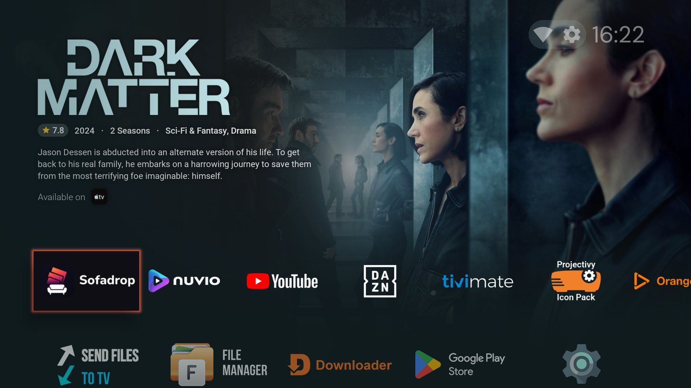
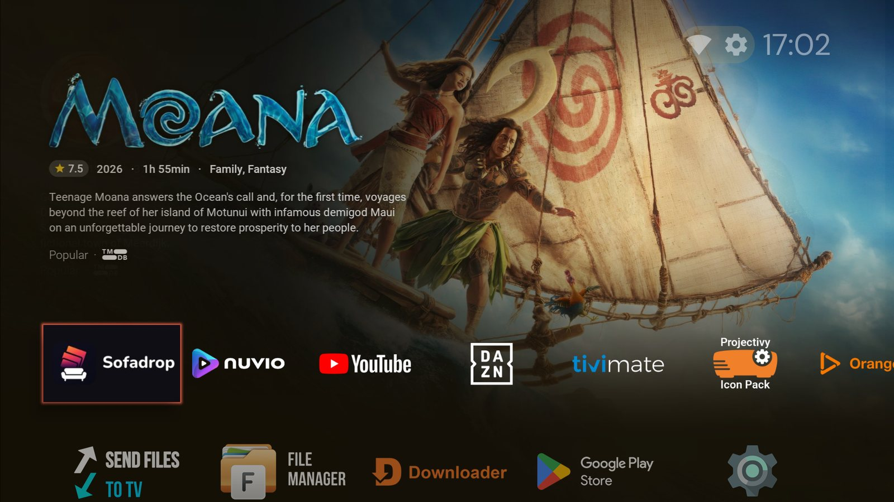
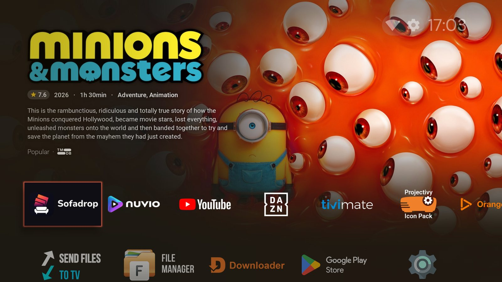
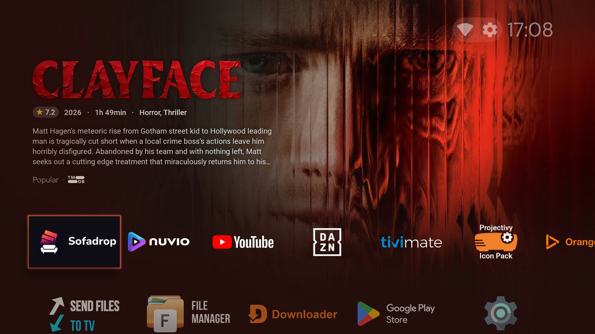
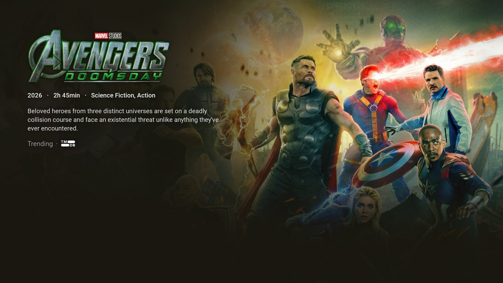
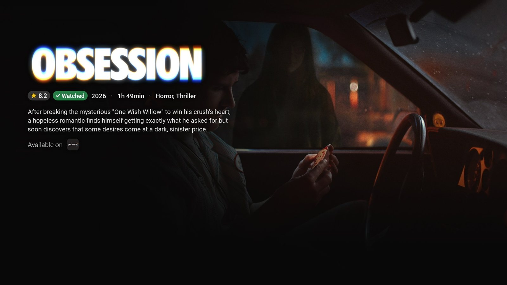
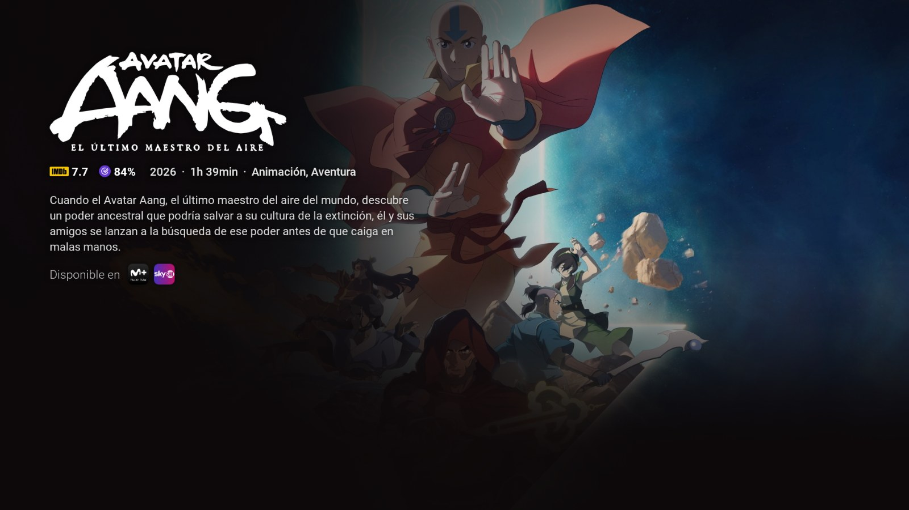
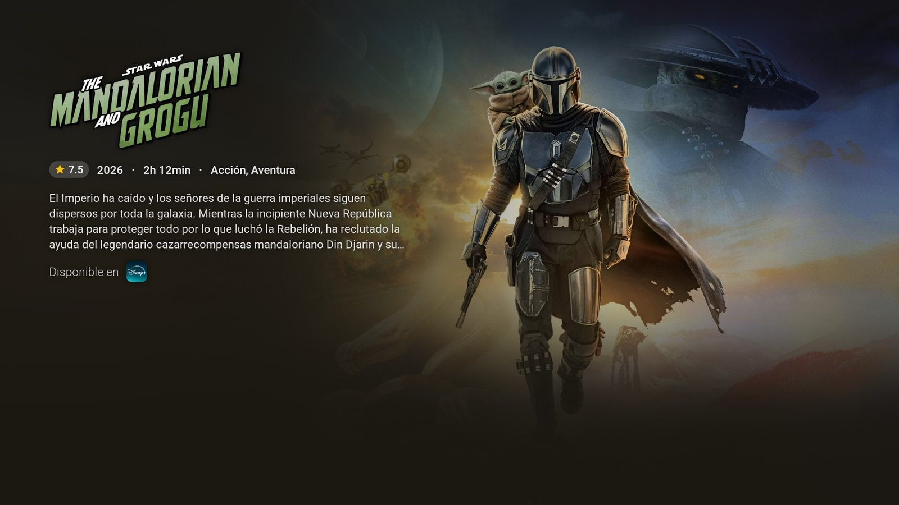
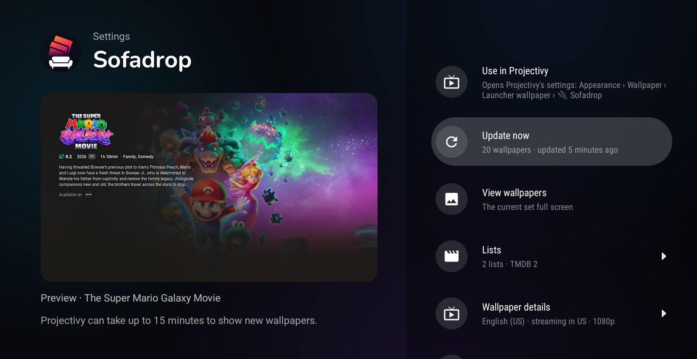

# Sofadrop

**Movie & TV backdrops for Projectivy Launcher.**

Sofadrop is a wallpaper plugin for [Projectivy Launcher](https://github.com/spocky/miproja1) (Android TV) that turns your home screen into a rotating showcase of **movies and TV shows** from the lists you choose: what's trending, your Trakt or Simkl lists, any public MDBList list… Everything is generated **on your TV** and set up from inside the launcher, with a live preview.

> ⚠️ Projectivy marks third-party wallpaper plugins as a **Premium** feature. No Premium? [androidtvbackground-reddit](https://github.com/rfmarcos/androidtvbackground-reddit) publishes wallpapers with the same design to [r/AndroidTVWallpapers](https://www.reddit.com/r/AndroidTVWallpapers) (English) and [r/AndroidTVWallpapersES](https://www.reddit.com/r/AndroidTVWallpapersES) (Spanish), which work with Projectivy's free Reddit source: simpler, but nothing to install.

## ✨ Features

* 🎬 **Your lists**: TMDB trending, popular, in cinemas, upcoming, top rated and on the air (no account needed); Trakt, Simkl and MDBList lists, including your watchlists and any public MDBList list.
* 📱 **Nothing to type on the TV**: accounts connect by scanning a QR code with your phone.
* 🖼️ **Clean, readable wallpapers**: textless backdrops with the title's logo, rating, year, runtime or seasons, genres and synopsis, kept clear of the launcher rows.
* 📺 **Where to watch it**: the streaming services that have each title in your country, or the list it came from.
* ✅ **Watched titles**: with your Trakt or Simkl history, mark what you've seen ("✓ Watched", "▶ Watching · 3/8") or hide it.
* 🎯 **Filters**: maximum age, global hits only, no adult content, no repeats, and only titles with a logo or a synopsis in your language. Every list can have its own.
* 🔎 **Explore your lists**: see each list's titles in order and which ones are used or skipped, and why.
* 🔀 **Mixed or in order**: all lists shuffled together, or one after another.
* 🌍 **Languages**: English, Spanish, Portuguese, French, Italian and German wallpapers.
* 🔄 **Updates itself**: new versions are offered inside the app.

## 📸 Screenshots

| | |
|---|---|
|  |  |
|  |  |
|  |  |
|  |  |

*Titles watched on Trakt or Simkl get a badge (or can be hidden), the footer shows where to watch each title, and wallpapers come in six languages (Spanish above).*

## 📥 Installation

1. **With [Downloader](https://www.aftvnews.com/downloader/)**, enter the code **`7882519`**. Or download the latest APK: [**sofadrop.apk**](https://github.com/rfmarcos/projectivy-plugin-sofadrop/releases/latest/download/sofadrop.apk) (this link always points to the newest version; see all [releases](../../releases)).
2. Install it on your Android TV (Downloader does it for you; otherwise use *Send Files to TV* or `adb install`).
3. In Projectivy go to **Settings → Appearance → Wallpaper → Launcher wallpaper** and pick **🔌 Sofadrop**.

That's it: the first wallpapers are ready in a minute or two. Choose **Configure** in the same screen (or open Sofadrop from your apps) to pick your lists and style.

> **Google Play Protect** may block the install with *"Play Protect doesn't recognise other apps from this developer"*. Sofadrop isn't on Google Play, so Google doesn't know its developer yet. Choose **More details → Install anyway**.

## ⚙️ Settings

The left side of the settings shows a **live preview** of a wallpaper with your current choices. Changes are applied when you leave the settings, or right away with **Update now**.

* **Update now** also shows the status: how many wallpapers you have, when they were updated, or the progress while generating.
* **View wallpapers** shows the current set full screen (◀ ▶ to browse, **OK** to use one in the preview).
* **Lists**
  * *Titles per list*, *Title picking* (at random or the top of each list) and *Order in the launcher* (mixed or one list after another).
  * One screen per service, **TMDB**, **Trakt**, **Simkl** and **MDBList**, to tick lists and connect your account.
  * **Filters & explore lists**: the filters for every list, then your lists. Open one to see its titles and give it its own filters.
* **Wallpaper details**: language, synopsis length, the footer (streaming services and/or the list source), the streaming country, what to do when the logo or synopsis isn't in your language, and resolution (1080p or 4K).
* **Update every**: how often a new set is generated (6 hours to 7 days). How often the wallpaper *changes on screen* is set in Projectivy itself.

### Connecting your accounts (optional)

* **Trakt**: *Lists → Trakt → Your Trakt account*, then scan the QR code. Adds your recommendations and watchlist, and your history can mark or hide watched titles.
* **Simkl**: trending anime, movies and shows work without an account. Connect it to add your *Plan to watch* and *Watching* lists and your history.
* **MDBList**: tick a suggested public list or add any public one by `user/list` or its URL, no account needed. Connect your account to load your own lists, private ones included.

## 🔄 Updates

When a new version is published, **Update available** appears at the top of the settings. Choose it to download and install it; your settings are kept. The first time, Android asks you to allow Sofadrop to install apps. If Play Protect blocks it, choose **More details → Install anyway**.

## ☕ Support

Sofadrop is free and open source. If you enjoy it, you can buy me a coffee:

Bug reports and ideas are welcome in the [issues](../../issues). Want to build it yourself? See [BUILDING.md](BUILDING.md).

## 🧾 Credits

* Based on the official [Projectivy wallpaper provider template](https://github.com/spocky/projectivy-plugin-wallpaper-provider) by spocky (Apache 2.0).
* Movie and TV data, images and logos from [TMDB](https://www.themoviedb.org/). *This product uses the TMDB API but is not endorsed or certified by TMDB.*
* Lists and watch history from [Trakt](https://trakt.tv/), [Simkl](https://simkl.com/) and [MDBList](https://mdblist.com/). *Sofadrop uses Trakt but is not endorsed or certified by Trakt.*
* The Trakt logo is the official dark-background logo from [trakt.tv/branding](https://trakt.tv/branding), used unaltered; the Simkl and MDBList logos come from their own sites. All names and logos belong to their owners.
* Streaming availability from TMDB Watch Providers, powered by [JustWatch](https://www.justwatch.com/).
* [Roboto](https://github.com/googlefonts/roboto) (Apache 2.0) and [Nunito](https://github.com/googlefonts/nunito) (SIL Open Font License 1.1) fonts, and Material Icons (Apache 2.0).

## 📜 License

Apache License 2.0, see [LICENSE](LICENSE).
