# Sofadrop

**Movie & TV backdrops for Projectivy Launcher.**

Sofadrop is a wallpaper plugin for [Projectivy Launcher](https://github.com/spocky/miproja1) (Android TV) that turns your home screen into a rotating showcase of **movies and TV shows** from the lists you choose: what's trending, your Trakt or Simkl lists, any public Trakt or MDBList list… Everything is generated **on your TV** and set up from inside the launcher, with a live preview.

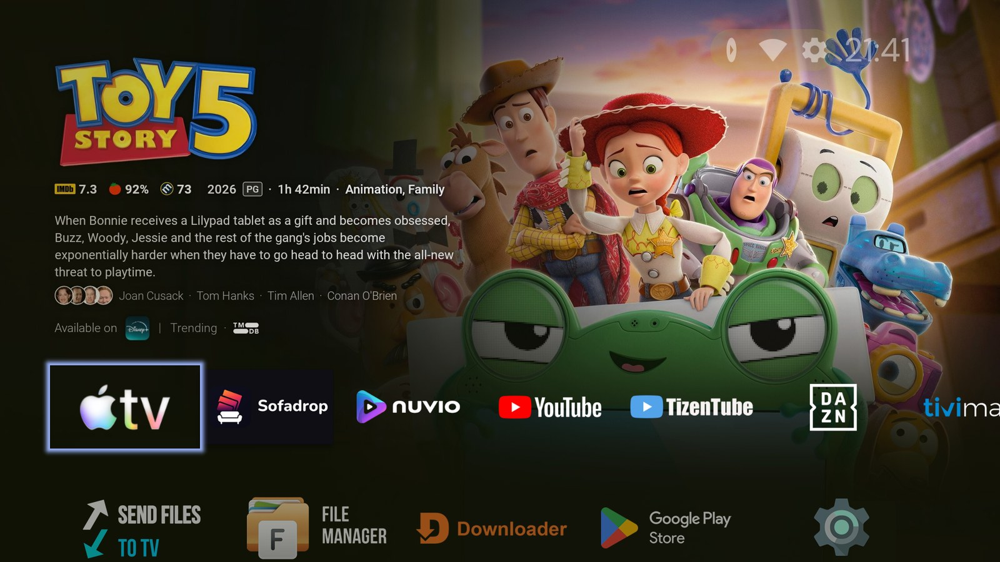

> ⚠️ Projectivy marks third-party wallpaper plugins as a **Premium** feature. No Premium? [androidtvbackground-reddit](https://github.com/rfmarcos/androidtvbackground-reddit) publishes wallpapers with the same design to [r/AndroidTVWallpapers](https://www.reddit.com/r/AndroidTVWallpapers) (English) and [r/AndroidTVWallpapersES](https://www.reddit.com/r/AndroidTVWallpapersES) (Spanish), which work with Projectivy's free Reddit source: simpler, but nothing to install.

## ✨ Features

* 🎬 **Your lists**: TMDB trending, popular, in cinemas, upcoming, top rated and on the air (no account needed); Trakt, Simkl and MDBList lists, including your watchlists and any public Trakt or MDBList list.
* 📱 **Nothing to type on the TV**: accounts connect by scanning a QR code with your phone.
* 🖼️ **Clean, readable wallpapers**: textless backdrops with the title's logo, rating, year, runtime or seasons, genres, synopsis and cast (with their photos), kept clear of the launcher rows. Put the text in any corner, and use black shading on OLED screens.
* ⭐ **The ratings you trust**: IMDb, Rotten Tomatoes (critics and audience), Metacritic, Letterboxd, TMDB, Trakt or MyAnimeList, with their logos, in the order you choose. IMDb, TMDB and Trakt work without any account; the others come from MDBList.
* 📺 **Where to watch it**: the streaming services that have each title in your country, or the list it came from.
* ▶️ **Open it from the wallpaper**: Projectivy's play button opens the title on your streaming platforms (Netflix, Prime Video, Disney+, HBO Max, Apple TV…), in Nuvio, Stremio or Jellyfin, or its trailer on YouTube.
* ✅ **Watched titles**: with your Trakt or Simkl history, mark what you've seen ("✓ Watched", "▶ Watching · 3/8") or hide it.
* 🎯 **Filters**: maximum age (or from a year on), minimum TMDB rating, age rating, global hits only, no adult content, no repeats, skip some genres (or use only some), and only titles with a logo or a synopsis in your language. Every list can have its own, and any title can be blocked.
* 🔎 **Explore your lists**: see each list's titles in order and which ones are used or skipped, and why.
* 🔀 **Mixed or in order**: all lists shuffled together, or one after another.
* 🌙 **Screensaver too**: Sofascreen shows the wallpapers full screen as Android's screensaver, with a clock and the weather, also without Projectivy ([how to switch it on](#screensaver)).
* 🌍 **Languages**: English, Spanish, Portuguese, French, Italian, German, Dutch, Swedish, Norwegian, Danish, Finnish, Polish, Czech, Hungarian, Romanian, Turkish, Greek, Russian and Ukrainian wallpapers. When TMDB has no logo or synopsis in yours, you choose what to show instead, and titles from other alphabets (Japanese, Korean…) can show in English.
* 🔄 **Updates itself**: new versions are offered inside the app.

## 📸 Screenshots

| | |
|---|---|
| 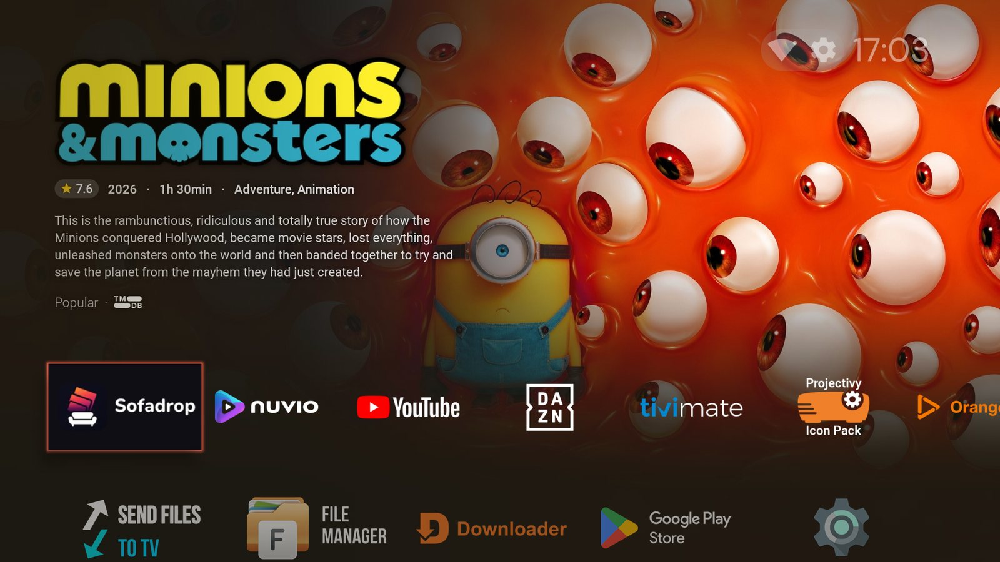 | 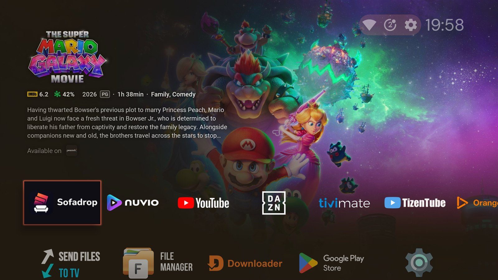 |
| 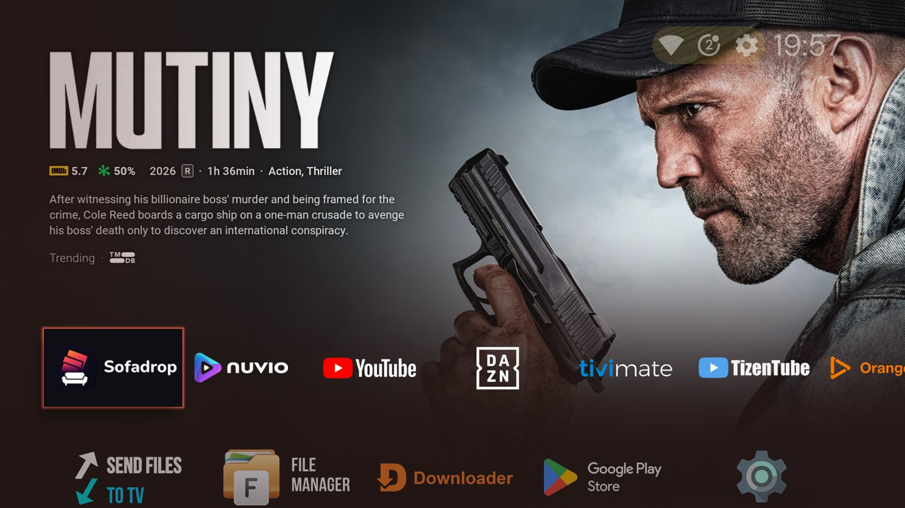 | 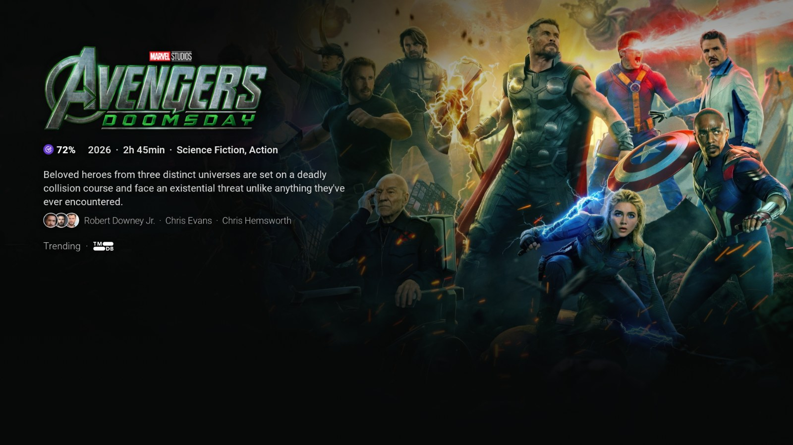 |
| 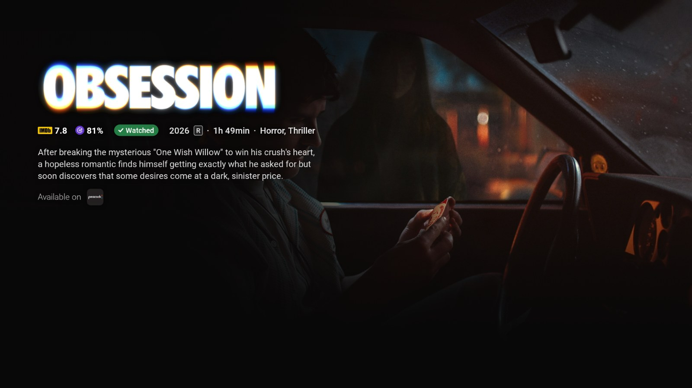 |  |
| 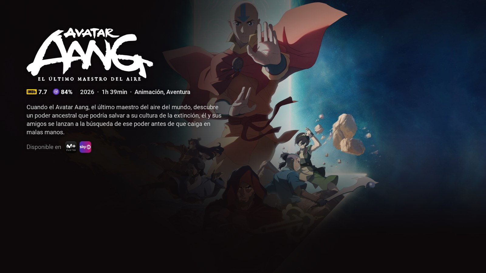 | 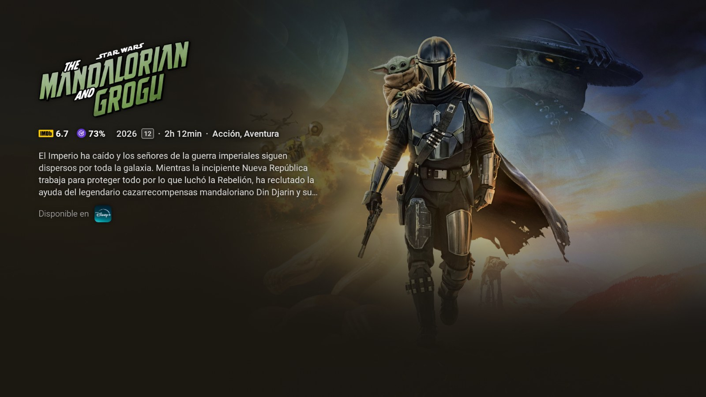 |
| 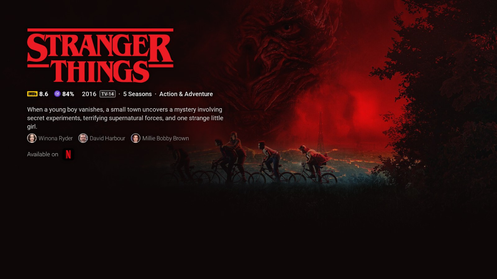 | 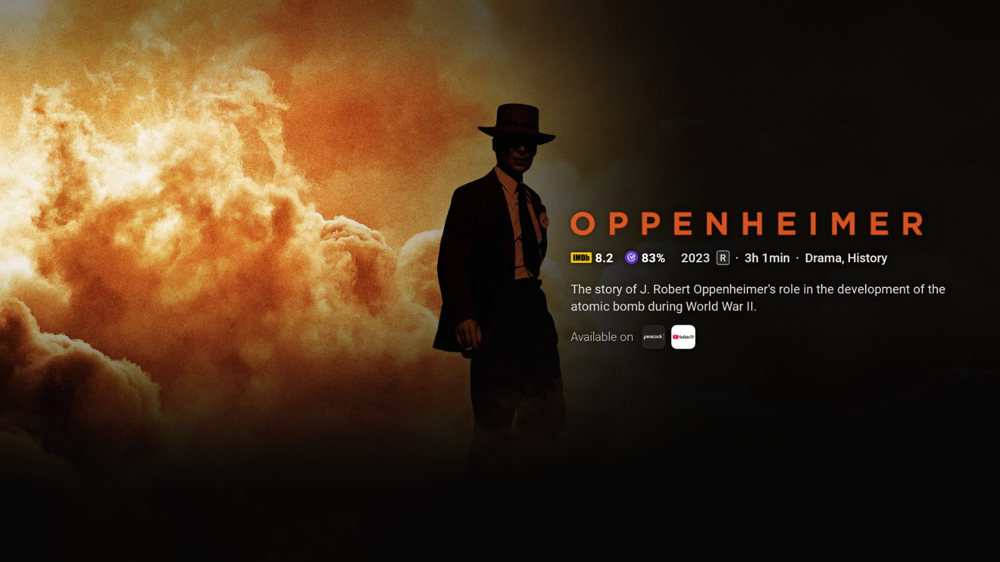 |
| 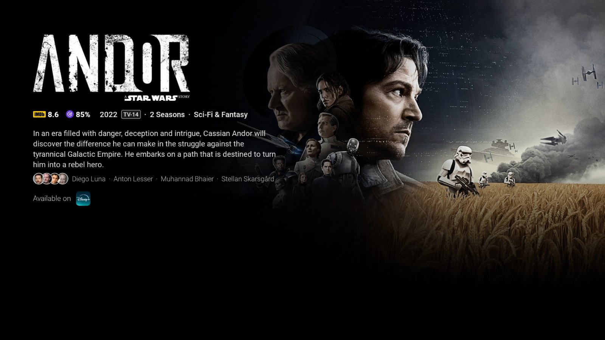 | 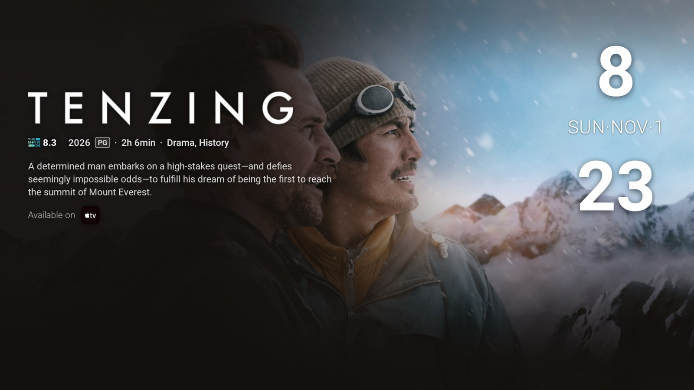 |

*Ratings come with each platform's logo (IMDb and Trakt above, no account needed; Rotten Tomatoes, Metacritic and more with MDBList), next to the age rating. Titles watched on Trakt or Simkl get a badge (or can be hidden), the footer shows where to watch each title, the cast can go under the synopsis with their photos, the text can go in any corner, the shading can be pure black for OLED screens, and wallpapers come in 19 languages (Spanish above). The last one is Sofascreen, the screensaver.*

## 📥 Installation

1. **With [Downloader](https://www.aftvnews.com/downloader/)**, enter the code **`7882519`**. Or download the latest APK: [**sofadrop.apk**](https://github.com/rfmarcos/projectivy-plugin-sofadrop/releases/latest/download/sofadrop.apk) (this link always points to the newest version; see all [releases](../../releases)).
2. Install it on your Android TV (Downloader does it for you; otherwise use *Send Files to TV* or `adb install`).
3. In Projectivy go to **Settings → Appearance → Wallpaper → Launcher wallpaper** and pick **🔌 Sofadrop**.

Then choose **Configure** in the same screen (or open Sofadrop from your apps): the first time, a short **guided setup** asks for your style, lists and amount, with a preview, and the first wallpapers are ready in a minute or two. You can open it again from *Settings → About*.

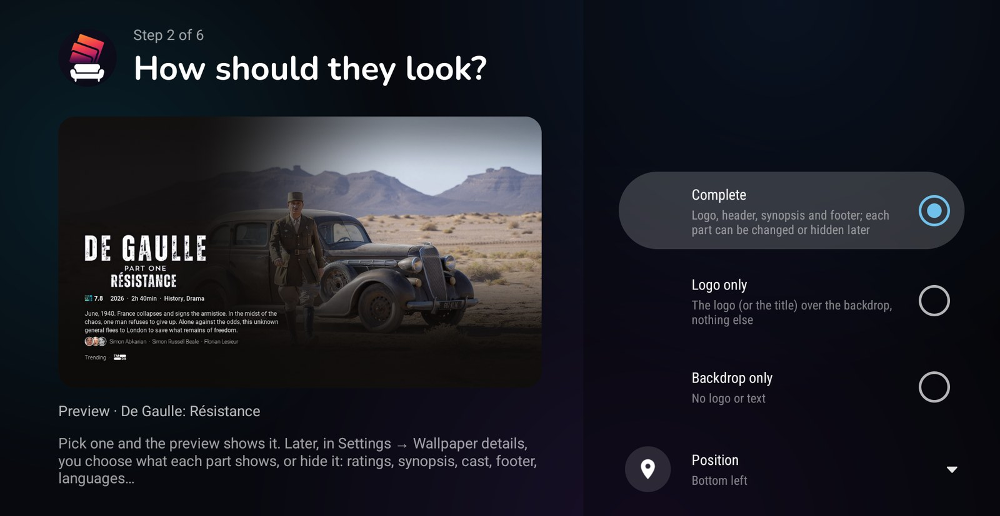

> **Google Play Protect** may block the install with *"Play Protect doesn't recognise other apps from this developer"*. Sofadrop isn't on Google Play, so Google doesn't know its developer yet. Choose **More details → Install anyway**.

## ⚙️ Settings

The left side of the settings shows a **live preview** of a wallpaper with your current choices. Changes are applied when you leave the settings, or right away with **Update now**.

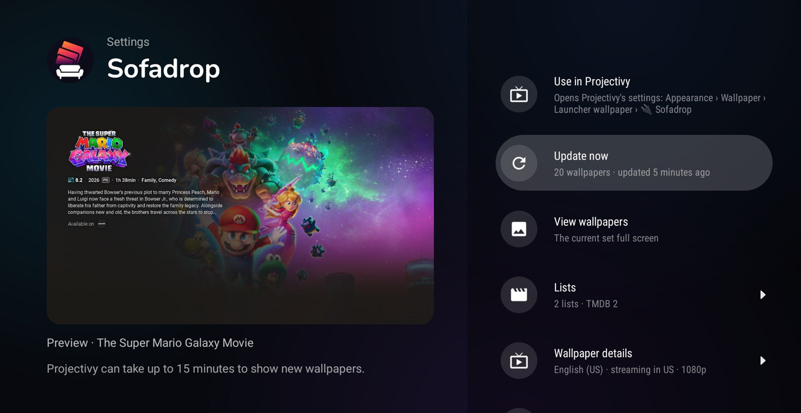

* **Update now** also shows the status: how many wallpapers you have, when they were updated, or the progress while generating.
* **View wallpapers** shows the current set full screen (◀ ▶ to browse, **OK** to use one in the preview, ▲ to open what the wallpaper opens from Projectivy, ▼ to block the title).
* **Lists**
  * *Titles per list*, *Title picking* (at random or the top of each list) and *Order in the launcher* (mixed or one list after another). An update makes at most 200 wallpapers, shared among the lists; Projectivy shows 100 of them at a time, a different 100 at random each time it reloads.
  * One screen per service, **TMDB**, **Trakt**, **Simkl** and **MDBList**, to tick lists and connect your account. Trakt and MDBList also take any public list by its URL or `user/list`.
  * **Filters & explore lists**: the filters for every list, then your lists. Open one to see its titles, block one, or give the list its own filters. *Blocked titles* lists the ones you blocked, to unblock them.
* **Wallpaper details**: style (complete, logo only or backdrop only), position of the text, shading (the backdrop's colour or black for OLED) and resolution (1080p or 4K); then by parts: the language of each part, the header under the title (which ratings, in what order, and whether to show the year, runtime, genres and watched badge; hiding details leaves room for more ratings), synopsis length and cast (names only or with their photos), and the footer (streaming services and/or the list source, and the streaming country).
* **On wallpaper click**: what Projectivy's play button (or *About this wallpaper*) opens. Your streaming platforms in the order you pick, then, if the title is on none of them, its trailer (in the language you choose), Nuvio, Stremio or Jellyfin, or nothing.
* **Accounts**: connect TMDB, Trakt, Simkl and MDBList with a QR code, see what each one adds, and update the IMDb ratings data.
* **Screensaver**: the same wallpapers, or lists and a look of its own; time per wallpaper, transition, slow zoom, clock, date, brightness and weather. See [Screensaver](#screensaver).
* **Update every**: how often a new set is generated (6 hours to 7 days). How often the wallpaper *changes on screen* is set in Projectivy itself.
* **About**: the guided setup again, the *Last generation log* (lists, failures and how long the last update took) and *Version*, which checks for updates.

### Connecting your accounts (optional)

* **Trakt**: public lists need no account. Connect it in *Accounts → Trakt* by scanning the QR code to add your recommendations, watchlist and your own lists; your history can mark or hide watched titles.
* **Simkl**: trending anime, movies and shows work without an account. Connect it to add your *Plan to watch* and *Watching* lists and your history.
* **MDBList**: tick a suggested public list or add any public one by `user/list` or its URL, no account needed. Connect your account to load your own lists, private ones included, and to show Rotten Tomatoes, Metacritic, Letterboxd and MyAnimeList ratings (*Wallpaper details → Header*). Ratings take one request per list from your MDBList daily quota.

<a id="screensaver"></a>
## 🌙 Screensaver

Sofadrop includes **Sofascreen**, a screensaver that shows your wallpapers full screen with a clock (and the weather, if you want). It works with or without Projectivy. Set it up in *Settings → Screensaver*; **Try it** shows it right away.

To make it the TV's screensaver, choose *Settings → Screensaver → Switch it on*:

* **Android TV** devices that list other apps' screensavers open Android's screensaver settings: choose **Sofascreen**. On TVs without a direct link it opens Android's settings instead: go to *Device Preferences → Screen saver* (the names can change with the TV's brand).
* **Google TV** (Chromecast with Google TV, Google TV Streamer, TVs with Google TV) only offers Google's own screensavers. Sofascreen is switched on **once** from a computer on the same Wi-Fi, with `adb` from Google's [platform-tools](https://developer.android.com/tools/releases/platform-tools). Sofadrop shows these same steps with your TV's address filled in:
  1. Turn on the developer options: *Settings → System → About*, then press **OK** 7 times on *Android TV OS build*.
  2. Turn on wireless debugging: *Settings → System → Developer options → Wireless debugging*, then *Pair device with pairing code*. Leave that screen open: it shows the TV's address, a port and a code.
  3. On the computer, with the TV's address (`IP`):
     ```
     adb pair IP:PORT CODE
     adb connect IP:PORT
     adb shell settings put secure screensaver_components com.rfmarcos.sofadrop/com.rfmarcos.sofadrop.SofascreenService
     ```
     `adb pair` takes the port and code from the pairing screen; `adb connect` takes the port shown under *Wireless debugging* (*IP address & port*).
  4. That's all: wireless debugging and the developer options can be turned off again.

> **With Projectivy**, turn off *Settings → Appearance → Launcher Idle Mode → Prevent system screensaver*, then restart the TV: otherwise Projectivy keeps any system screensaver from starting.

To go back to Google's screensaver:

```
adb shell settings put secure screensaver_components com.google.android.apps.tv.dreamx/.service.Backdrop
```

## 🔄 Updates

When a new version is published, **Update available** appears at the top of the settings, within about 12 hours (or right away with *About → Version*). Choose it to see what's new and install it; your settings are kept. The first time, Android asks you to allow Sofadrop to install apps. If Play Protect blocks it, choose **More details → Install anyway**.

## ☕ Support

Sofadrop is free and open source. If you enjoy it, you can buy me a coffee:

[](https://ko-fi.com/rfmarcos)

Bug reports and ideas are welcome in the [issues](../../issues). Want to build it yourself? See [BUILDING.md](BUILDING.md).

## 🧾 Credits

* Based on the official [Projectivy wallpaper provider template](https://github.com/spocky/projectivy-plugin-wallpaper-provider) by spocky (Apache 2.0).
* Movie and TV data, images and logos from [TMDB](https://www.themoviedb.org/). *This product uses the TMDB API but is not endorsed or certified by TMDB.*
* Lists and watch history from [Trakt](https://trakt.tv/), [Simkl](https://simkl.com/) and [MDBList](https://mdblist.com/). *Sofadrop uses Trakt but is not endorsed or certified by Trakt.*
* The Trakt logo is the official dark-background logo from [trakt.tv/branding](https://trakt.tv/branding), used unaltered; the Simkl and MDBList logos come from their own sites. Ratings come from MDBList and Trakt; without MDBList, IMDb ratings come from IMDb's official [dataset](https://developer.imdb.com/non-commercial-datasets/) (about 9 MB, refreshed weekly). *Information courtesy of IMDb (https://www.imdb.com). Used with permission.* The IMDb, Rotten Tomatoes, Metacritic, Letterboxd and MyAnimeList logos are the versions on [Wikimedia Commons](https://commons.wikimedia.org/), used unaltered next to each score. All names and logos belong to their owners.
* Streaming availability from TMDB Watch Providers, powered by [JustWatch](https://www.justwatch.com/); links to each title on the streaming apps from [Wikidata](https://www.wikidata.org/).
* Sofascreen, the screensaver, started from [schumi2004](https://github.com/schumi2004)'s work, who also contributed the Dutch translation, the minimum rating, the block list and more. Weather by [Open-Meteo](https://open-meteo.com/). The Projectivy screensaver tip comes from Sofadrop Screensaver by ilee ([itslee.nl](https://itslee.nl)).
* [Roboto](https://github.com/googlefonts/roboto) (Apache 2.0) and [Nunito](https://github.com/googlefonts/nunito) (SIL Open Font License 1.1) fonts, and Material Icons (Apache 2.0).
* Thanks to [adelatour11/androidtvbackground](https://github.com/adelatour11/androidtvbackground), the script that started [androidtvbackground-reddit](https://github.com/rfmarcos/androidtvbackground-reddit) and, through it, this plugin.

## 📜 License

Apache License 2.0, see [LICENSE](LICENSE).
