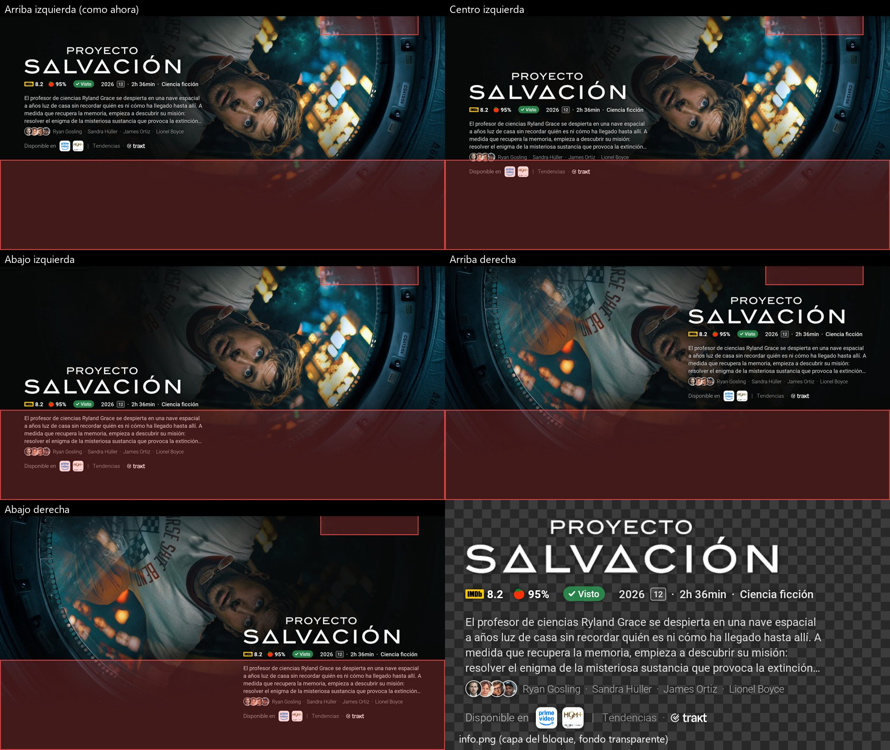
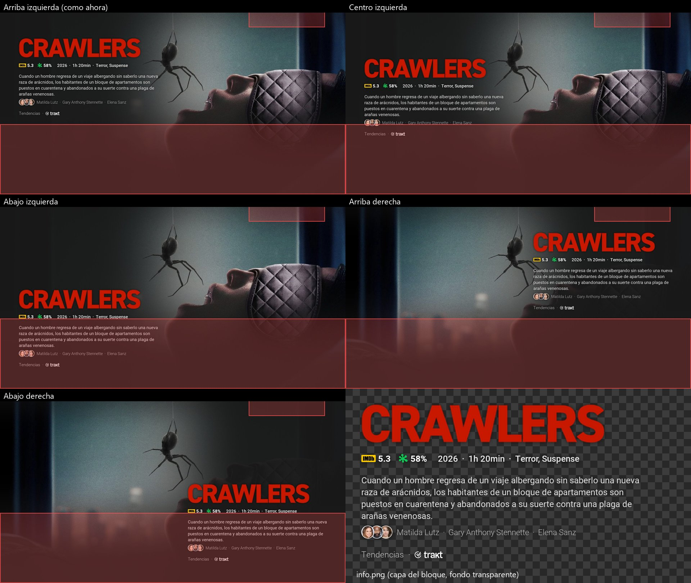

# T9. Dibujado en capas y posición del bloque (diseño)

Documento para aprobar **antes** de tocar el renderizador de verdad. Las cifras salen de un prototipo en la rama `1.2/layers` (`LayersBench`, solo en la Dev), medido en el Chromecast con Google TV el 2026-10-31. Configuración: estilo completo, sinopsis de 4 líneas y fotos del reparto agrupadas, que es el bloque más grande que hay.

## Resumen

* Por cada título se guardan dos capas más: `NN-bg.jpg` (el fondo recortado, con los degradados de arriba y abajo) y `NN-info.png` (el bloque transparente con su sombra, recortado a su caja).
* El `NN.jpg` que ve Projectivy se sigue guardando: se monta a partir de las capas y sale **igual que ahora**. La diferencia media con el renderizador actual es de 0,05–0,07 sobre 255.
* Cambiar la posición solo vuelve a montar, sin red. 200 fondos tardan 1 minuto en 1080p y unos 4 en 4K.
* El salvapantallas (T10) dibuja las capas directamente en pantalla: no codifica nada y nunca vuelve a dibujar el fondo.
* Coste:
  * el disco se multiplica por ~2,9 (×3,6 en el prototipo, ver "Por qué ocupa tanto"): 200 fondos en 4K pasan de ~170 MB a ~480 MB;
  * generar tarda algo más, porque hay que codificar dos imágenes más por título.
* Posiciones propuestas: las cinco, tanto en el fondo como en el salvapantallas.
  * En el fondo, **arriba a la izquierda** por defecto (como ahora).
  * En el salvapantallas, **abajo a la izquierda** por defecto.

## Posiciones

Las capturas son de fondos reales de la TV (4K, reducidas). Las zonas en rojo son lo que tapa Projectivy **con la configuración de Rubén**:

* las filas de apps, desde el 64 % de la altura hacia abajo;
* el reloj y los iconos de estado, arriba a la derecha.

Otros usuarios tienen otra configuración de Projectivy: menos filas, filas más bajas, filas ocultas, o sin reloj. Por eso no se quita ninguna posición; lo que sigue es lo que pasa con una configuración como la de Rubén.

El último recuadro es `info.png` sobre un damero, para ver qué es la capa.





Qué se ve:

* **Arriba izquierda:** es la de ahora. Con sinopsis y reparto, el bloque llega justo hasta las filas.
* **Centro izquierda:** el pie (plataformas y lista) cae debajo de las filas.
* **Abajo izquierda / abajo derecha:** las filas tapan la mitad del bloque. Sirven en el salvapantallas, o en el fondo si se ocultan o reducen las filas de Projectivy.
* **Arriba derecha:**
  * Cabe igual que arriba a la izquierda.
  * Con logos altos, el logo roza la zona del reloj. Se puede bajar un poco el bloque en esa posición.
  * Los fondos de TMDB suelen tener al protagonista en el centro o a la derecha, así que el bloque lo tapa más a menudo (se ve en Proyecto Salvación).

**Propuesta:**

| | Posiciones | Por defecto |
|---|---|---|
| Fondo de Projectivy | Las cinco | Arriba izquierda |
| Salvapantallas (T10) | Las cinco | Abajo izquierda, o "como el fondo" |

La explicación del ajuste en el fondo avisa de que, con las filas de Projectivy a la vista, las posiciones de abajo y del centro pueden quedar tapadas.

Limitación: el bloque se dibuja una sola vez, así que en las posiciones de la derecha el texto sigue alineado a la izquierda dentro del bloque (se ve en las capturas). Alinearlo a la derecha obligaría a dibujar otro `info.png` por alineación. Propongo dejarlo así.

## Formato de ficheros

En cada generación (`files/wallpapers/gen-<hora>/`):

| Fichero | Qué es | Ya existe |
|---|---|---|
| `NN.jpg` | El fondo montado que se entrega a Projectivy, en la posición elegida | Sí, igual que ahora |
| `NN-bg.jpg` | El fondo recortado al tamaño del fondo de pantalla, con los degradados de arriba (reloj) y abajo (filas) ya pintados. JPEG calidad 85 (ver "Cuánto se puede recortar") | Nuevo |
| `NN-info.png` | El bloque (logo, cabecera, sinopsis, reparto, pie, insignias) con su sombra, transparente y recortado a su caja | Nuevo |

Campos nuevos en cada entrada de `index.json` (`StoredWallpaper`). Todos son opcionales, así que un `index.json` antiguo se sigue leyendo (`ignoreUnknownKeys` y valores por defecto):

```kotlin
val background: String? = null,  // "07-bg.jpg"; null = set sin capas
val info: String? = null,        // "07-info.png"; null = sin bloque (estilo "solo el fondo")
val infoLeft: Int = 0,           // dónde va el bloque arriba a la izquierda; el resto de posiciones se calcula
val infoTop: Int = 0,
val tint: Int = 0,               // color del degradado lateral, sacado del propio fondo
val position: String = "top_left", // la posición con la que se montó NN.jpg
```

Por qué así:

* **Los degradados de arriba y abajo van dentro de `bg.jpg`.** No dependen de la posición, y pintarlos es lo más caro de montar: en 4K, montar baja de 0,84 s a 0,38 s. Al montar solo se pinta el degradado lateral, que cambia de lado según la posición.
* **`NN.jpg` se sigue guardando.** Otra opción era montarlo cuando Projectivy lo pide (en `WallpaperContentProvider`): se ahorra ~0,8 MB por título en 4K, pero cada fondo tardaría ~1,5 s en aparecer y Projectivy pide varios seguidos. No compensa.
* **PNG o WebP sin pérdida para `info`.** WebP sin pérdida ocupa un 20–25 % menos y en bloques pesados codifica más rápido (The Batman en 4K: 1,0 MB en 0,99 s, frente a 1,2 MB en 1,59 s con PNG). Pero `WEBP_LOSSLESS` es de Android 11 y la app admite desde Android 8. Propongo WebP sin pérdida en Android 11 o superior, y PNG en los demás; el lector decide por la extensión. WebP con pérdida se descarta: tarda entre 3 y 4 veces más en codificar.

## Cifras

Medidas en el Chromecast con Google TV. En 1080p son 5 títulos y en 4K son 3. Son medias, con el rango entre paréntesis.

### Disco por título

| | `NN.jpg` (ahora) | `bg.jpg` | `info.png` | `info.webp` | Total con capas |
|---|---|---|---|---|---|
| 1080p | 0,26 MB | 0,45 MB | 0,23 MB (0,19–0,34) | 0,17 MB | 0,94 MB (×3,6) |
| 4K | 0,83 MB | 1,42 MB | 0,70 MB (0,38–1,23) | 0,58 MB | 2,95 MB (×3,6) |

### Por qué ocupa tanto

* **El fondo se guarda dos veces:** una dentro de `NN.jpg` y otra en `bg.jpg`.
* **`bg.jpg` ocupa más que `NN.jpg` (1,42 frente a 0,83 MB en 4K):**
  * en `NN.jpg`, los degradados dejan casi negra la mitad de la imagen (la izquierda y la parte de abajo), y lo oscuro y liso comprime muy bien;
  * el `bg.jpg` del prototipo es el fondo entero, con todo el detalle.
* **`info.png` no tiene pérdida:** guarda exactos el logo, las fotos del reparto y la sombra. La sombra ocupa ~45 % de los píxeles del bloque y ~25 % de lo que pesa el fichero.

### Cuánto se puede recortar

Medido con los ficheros 4K de la TV, recodificados en el PC. Al recodificar `NN.jpg` sale un 3–6 % más grande que en Android, así que las cifras se pueden comparar.

| `bg.jpg` en 4K (media de 3) | Tamaño |
|---|---|
| Prototipo (sin degradados, calidad 90) | 1,42 MB |
| Con los degradados de arriba y abajo dentro, calidad 90 | 1,10 MB (−23 %) |
| Con los degradados de arriba y abajo dentro, calidad 85 | 0,89 MB (−37 %) |
| Con los tres degradados (para comparar: es `NN.jpg` sin el bloque) | 0,68 MB |

* **Propuesta:** degradados de arriba y abajo dentro de `bg.jpg` (ya estaba en el formato), con calidad 85. `bg` casi nunca se ve sin oscurecer, y en 4K la calidad 85 no se nota en la TV. Así quedan **2,4 MB por título en 4K (×2,9)**: con 200 fondos, ~480 MB en vez de ~590 MB. En 1080p, en proporción, ~150 MB.
* **La sombra fuera de `info`:** quitaría ~25 % del bloque, pero habría que desenfocarla otra vez en cada montaje. No compensa.
* **Bajar de ~×2:** solo se consigue no guardando una de las dos copias del fondo:
  * montar `NN.jpg` al vuelo (descartado arriba);
  * o no guardar `bg.jpg` y volver a descargar los fondos de TMDB al cambiar la posición: son solo imágenes, sin llamadas a la API, pero ya hace falta red.

  La caché HTTP (150 MB, que Android puede vaciar) no basta para contar con que los fondos sigan allí.

### Disco por set (prototipo; con los recortes de abajo, ~20 % menos)

| | 100 fondos (lo que muestra Projectivy) | 200 fondos (el tope) |
|---|---|---|
| 1080p | 26 → 94 MB | 52 → 188 MB |
| 4K | 83 → 295 MB | 166 → 590 MB |

Igual que ahora, mientras Projectivy no pida el set nuevo conviven el servido y el nuevo, así que en el peor caso hay que contar el doble. Al volver a montar por un cambio de posición, las capas no se copian a la generación nueva: se enlazan (enlace duro, y copia si falla).

### Tiempo de montaje (cambio de posición, por título)

| | Leer capas | Montar | Codificar `NN.jpg` | Total | 200 fondos |
|---|---|---|---|---|---|
| 1080p | 0,09 s | 0,10 s (0,21 sin degradados dentro) | 0,11 s | ~0,3 s | ~1 min |
| 4K | 0,33 s | 0,38 s (0,84) | 0,41 s | ~1,1 s | ~3,7 min |

Montar directamente sobre el `bg` leído (mutable) tarda lo mismo que crear un bitmap nuevo y en 4K ahorra 33 MB de memoria, así que lo propongo. Con dos hilos debería bajar casi a la mitad, pero no lo he medido.

### Tiempo de generación (por título)

* **Dibujar** cuesta lo mismo que ahora. Dibujar en capas y luego montar desde memoria (sin leer ni escribir disco) son las mismas operaciones que el `render()` de ahora: 1,7–2,1 s en 4K y ~0,6 s en 1080p, sin contar la red.
* **Lo nuevo es codificar `bg.jpg` e `info`:**
  * 4K: 0,45–0,54 s el fondo y 0,6–1,6 s el bloque, es decir, **+1,1–2,1 s por título** (+4–7 min con 200);
  * 1080p: **+0,3–0,5 s por título** (+1–1,7 min con 200).
* **Cómo recuperarlo:** codificar las capas en otro hilo mientras se descarga y dibuja el título siguiente. El Chromecast tiene 4 núcleos y la generación ya espera a la red. T10 pide que "generar no cueste más que antes": con el hilo aparte debería quedarse cerca, pero hay que medirlo en la implementación.

## Migración de los sets existentes

* **Sets hechos antes de T9** (sin `background` en `index.json`): siguen funcionando igual. Projectivy recibe sus `NN.jpg` y nada se regenera al actualizar.
* **Cambiar la posición con un set antiguo:** se regenera entero (con red), como hoy al cambiar cualquier ajuste de diseño al salir de los ajustes (`hasPendingChanges`). El set nuevo ya tiene capas.
* **Cambiar la posición con un set con capas:**
  * se monta una **generación nueva** (carpeta nueva y URIs nuevas), porque Projectivy guarda en caché las URIs que ya le dimos y no volvería a leer un `NN.jpg` sobrescrito;
  * se publica con `WallpaperStore.publish`, como una generación normal;
  * Projectivy la recoge en su siguiente petición (máximo 10 min).
* **Cualquier otro ajuste que cambie el bloque** (estilo, reparto, idioma, valoraciones…) cambia el contenido de `info.png`, así que sigue necesitando regenerar, como ahora. Solo la posición, y el salvapantallas, aprovechan las capas.
* **El salvapantallas con un set antiguo:** muestra los `NN.jpg` tal cual (con el bloque arriba a la izquierda) hasta la siguiente generación, que suele ser en pocas horas. No hace falta forzar nada.

## Salvapantallas (para T10)

* Dibuja `bg` + degradado lateral (`LinearGradient` en la GPU, prácticamente gratis) + `info` en una `View`. No codifica nada.
* En el Chromecast, la pantalla de la app es de 1920 px aunque la salida sea 4K. Se lee `bg` reducido al tamaño de pantalla (`inSampleSize`): unos 8 MB por fondo, y dos a la vez durante la transición.
* Su posición es independiente de la del fondo. Las posiciones de abajo tienen sentido allí porque no hay filas.

## Si se aprueba: pasos

1. El worker guarda las capas y monta `NN.jpg` desde memoria (sin dibujar dos veces). Las capas se codifican en otro hilo. Los campos nuevos van en `StoredWallpaper`.
2. Nuevo ajuste "Posición del bloque", junto a Estilo, con su explicación en en/es/nl. Al cambiarlo: volver a montar si el set tiene capas, o regenerar si no.
3. La vista previa de los ajustes usa el mismo montaje.
4. Pruebas:
   * test unitario de que se lee un `index.json` antiguo;
   * render instrumentado de las posiciones en el emulador;
   * medición del tiempo de generación y de montaje en la TV (Dev) a 1080p y 4K.

## Decisiones para Rubén

1. **Posiciones:** las cinco en el fondo y en el salvapantallas, con un aviso sobre las filas de Projectivy (propuesta tras la revisión de Rubén: lo que tapa Projectivy depende de cada configuración).
2. **Disco en 4K:** ¿aceptamos ~480 MB para 200 fondos en 4K (~240 MB para 100)? Si es mucho, las alternativas son:
   * guardar capas solo cuando se usan: con el salvapantallas activado, o con una posición distinta de la de por defecto;
   * no guardar `bg.jpg` y volver a descargar los fondos al cambiar la posición.
3. **`info`:** ¿WebP sin pérdida en Android 11 o superior, con PNG de respaldo (propuesta), o PNG siempre por sencillez?
